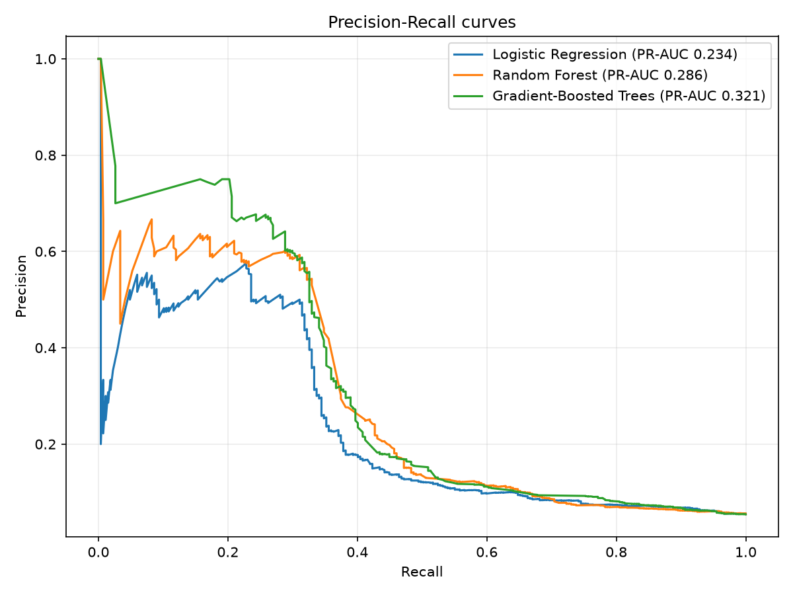
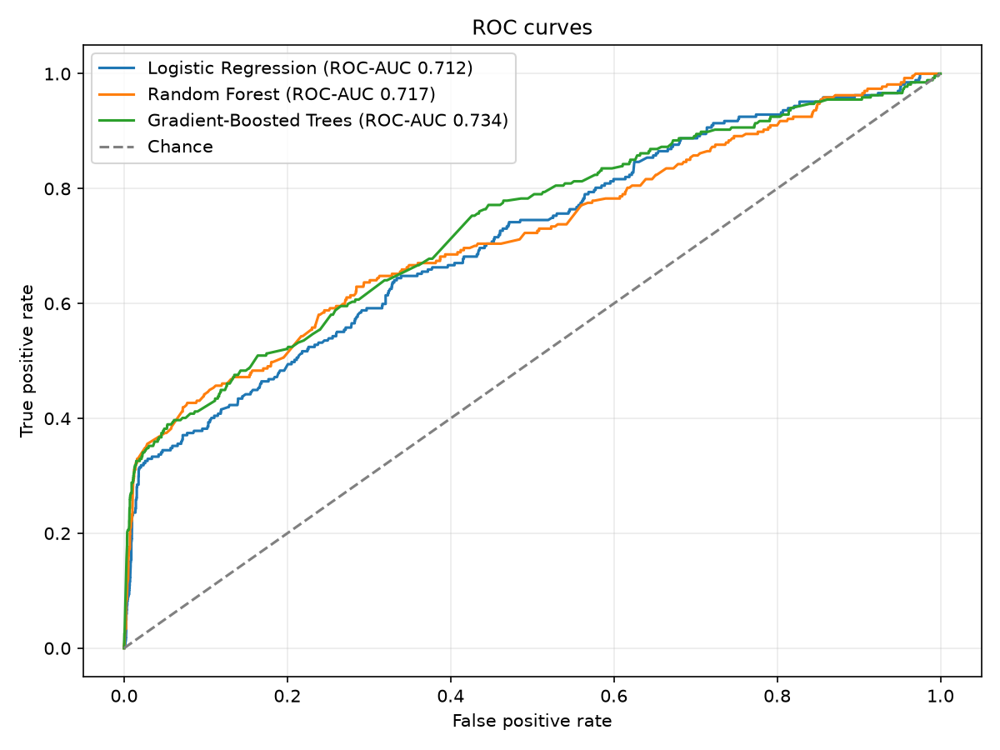

# Báo cáo đánh giá mô hình dự đoán mua hàng

Mô hình được chọn theo PR-AUC trên tập test: **Gradient-Boosted Trees**.
Tập train có 19,481 phiên; tập test có 4,902 phiên. Mốc chia thời gian Unix UTC: `1569902750`.

## So sánh mô hình

| Mô hình | PR-AUC | ROC-AUC | Precision | Recall | F1 |
|---|---:|---:|---:|---:|---:|
| Logistic Regression | 0.2336 | 0.7121 | 0.0753 | 0.7566 | 0.1370 |
| Random Forest | 0.2857 | 0.7172 | 0.1513 | 0.4794 | 0.2300 |
| Gradient-Boosted Trees | 0.3210 | 0.7342 | 0.1739 | 0.4494 | 0.2508 |

## Đường cong

## Đặc trưng quan trọng nhất

| Đặc trưng | Importance / |coefficient| |
|---|---:|
| cart_count | 0.197472 |
| avg_price | 0.138241 |
| distinct_products | 0.133742 |
| view_count | 0.127597 |
| max_price | 0.116243 |
| hour_of_day | 0.039130 |
| top_category_viewed=electronics.clocks | 0.022367 |
| distinct_categories | 0.021945 |
| top_category_viewed=appliances.kitchen.washer | 0.018514 |
| top_category_viewed=electronics.video.tv | 0.015605 |
| top_category_viewed=computers.notebook | 0.013573 |
| top_category_viewed=appliances.environment.air_heater | 0.011389 |
| top_category_viewed=electronics.audio.subwoofer | 0.011170 |
| top_category_viewed=appliances.kitchen.refrigerators | 0.009059 |
| top_category_viewed=electronics.smartphone | 0.008774 |

## Phân tích lỗi

### False positives

| user_id | user_session | label | P(purchase) |
|---:|---|---:|---:|
| 518150690 | 4691c261-095a-4a37-abef-4779a5e1fb2f | 0 | 0.9620 |
| 513852171 | b2e16429-cb07-43e5-8ac1-45819d852def | 0 | 0.9620 |
| 538260774 | 4fcd135e-da47-46d2-a170-152e96803e36 | 0 | 0.9617 |
| 514057010 | 2fc3a4be-24c8-417c-bfd7-cec7337d4809 | 0 | 0.9578 |
| 513257508 | b6027144-35a5-42a4-ae37-67fb629a262f | 0 | 0.9578 |
| 514880196 | b7b14dce-8be3-46b1-aa6d-58374972435b | 0 | 0.9578 |
| 526585634 | 80beb4de-487e-43b1-ace3-a10489e6215f | 0 | 0.9578 |
| 516998232 | fae50667-21cf-4e14-b338-8063374c49a6 | 0 | 0.9578 |
| 513425953 | 45094ac9-953b-460d-9b48-8f97885fe52e | 0 | 0.9578 |
| 521283225 | 0a7b9cf2-abd7-464f-b0e3-f5e7b8ed53b3 | 0 | 0.9578 |

### False negatives

| user_id | user_session | label | P(purchase) |
|---:|---|---:|---:|
| 532346257 | 23a26db5-d74c-4986-a797-90fdd7b1303b | 1 | 0.0691 |
| 555480956 | ccb91b0a-04c9-4e11-9461-612c1873ff02 | 1 | 0.0949 |
| 536721676 | e848ce05-537c-4490-ad78-a1ade7ae0d73 | 1 | 0.1034 |
| 515477415 | 6bf15e78-70ab-4fff-8342-70c8aebd376d | 1 | 0.1251 |
| 513651601 | 6175dacc-f71d-4580-a7d7-74ebefc70590 | 1 | 0.1564 |
| 515454306 | c7fcb0e5-144c-4add-b206-1b03d8368660 | 1 | 0.1605 |
| 530126866 | b359de66-cdb7-4521-95da-355192d622de | 1 | 0.1661 |
| 554959399 | f9f1d2b5-20c2-42f1-9ca7-19bc1c9a7b20 | 1 | 0.1682 |
| 512758756 | fd067274-2c94-4a36-b3d4-28e1a7b24352 | 1 | 0.1682 |
| 530928673 | fc7485f5-3846-444a-aff5-274b770fbd85 | 1 | 0.1954 |

## Giới hạn diễn giải

Báo cáo này được sinh từ dữ liệu đầu vào của lần chạy. Đặc trưng phiên dương chỉ dùng view/cart trước purchase đầu tiên; các encoder và scaler được fit trên train. Nếu đầu vào là sample 100k theo thứ tự thời gian, đây chỉ là smoke-test: các phiên sát cuối sample có thể bị right-censoring và không đại diện cho đánh giá cuối trên Silver đầy đủ.
