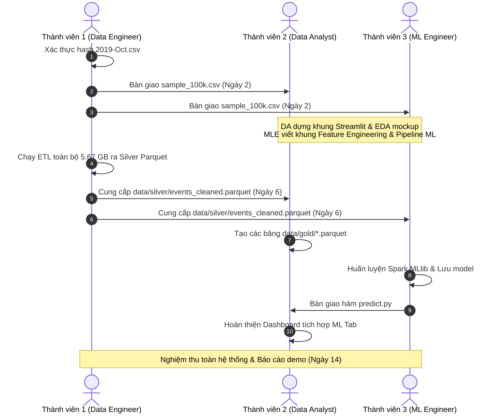

# Kế hoạch Tổng thể & Điều phối Dự án (Team Master Plan)

> **Dự án:** Phân tích Dữ liệu lớn Hành vi Thương mại Điện tử & Dự đoán Mua hàng  
> **Quy mô:** Nhóm 3 người | Thời gian: 2 tuần  
> **Kiến trúc Pipeline:** 6 Mốc (Raw Data $\rightarrow$ Ingestion $\rightarrow$ ETL $\rightarrow$ Storage $\rightarrow$ Machine Learning $\rightarrow$ Visualization)  
> **Tập dữ liệu:** REES46 eCommerce Events (`2019-Oct.csv`, 5.67 GB, ~42.4 triệu dòng)

---

## 1. Phân vai & Kế hoạch Chi tiết Từng Thành viên

Nhóm được phân chia theo 3 vai trò chuyên biệt, mỗi vai trò có một tài liệu kế hoạch hành động cụ thể trong thư mục `docs/`:

1. **[docs/member_1_data_engineer.md](file:///e:/Trung/Code/Python/Ph%C3%A2n%20t%C3%ADch%20d%E1%BB%AF%20li%E1%BB%87u%20l%E1%BB%9Bn/ecommerce-bigdata/docs/member_1_data_engineer.md)**
   * **Vai trò:** Data Engineer (Pipeline Lead)
   * **Phụ trách:** Pipeline 1 (Raw Data), Pipeline 2 (Ingestion), Pipeline 3 (ETL Core), Pipeline 4 (Storage Silver)
   * **Đầu ra chính:** `data/bronze/sample_100k.csv`, `src/ingestion/`, `src/etl/`, `data/silver/events_cleaned.parquet`.

2. **[docs/member_2_data_analyst.md](file:///e:/Trung/Code/Python/Ph%C3%A2n%20t%C3%ADch%20d%E1%BB%AF%20li%E1%BB%87u%20l%E1%BB%9Bn/ecommerce-bigdata/docs/member_2_data_analyst.md)**
   * **Vai trò:** Data Analyst & BI Lead
   * **Phụ trách:** Pipeline 3 (Analytics Aggregations), Pipeline 4 (Data Marts Gold), Pipeline 6 (Streamlit Dashboard)
   * **Đầu ra chính:** `src/analytics/`, các bảng `data/gold/*.parquet`, ứng dụng `dashboard/app.py`.

3. **[docs/member_3_ml_engineer.md](file:///e:/Trung/Code/Python/Ph%C3%A2n%20t%C3%ADch%20d%E1%BB%AF%20li%E1%BB%87u%20l%E1%BB%9Bn/ecommerce-bigdata/docs/member_3_ml_engineer.md)**
   * **Vai trò:** Machine Learning Engineer
   * **Phụ trách:** Pipeline 5 (Machine Learning: Trích xuất đặc trưng, Huấn luyện, Đánh giá), Pipeline 6 (Tích hợp suy luận)
   * **Đầu ra chính:** `src/ml/`, `data/gold/ml_features.parquet`, mô hình `models/best_purchase_model/`, `docs/model_evaluation_report.md`.

---

## 2. Quy ước Hợp tác & Phối hợp Song song (Collaboration Strategy)

Để tránh tình trạng "người này ngồi chờ người kia xong mới làm được", nhóm áp dụng chiến lược **Data Contract & Mock Data**:

---

## 3. Quy tắc Quản lý Mã nguồn (Git Workflow)

1. **Branch chính:**
   * `main`: Chỉ chứa mã nguồn hoàn chỉnh, đã test chạy được.
   * `dev`: Nhánh tích hợp chung của cả nhóm.
2. **Nhánh riêng của từng thành viên:**
   * Thành viên 1: `feature/de-ingestion-etl`
   * Thành viên 2: `feature/da-analytics-dashboard`
   * Thành viên 3: `feature/mle-model-training`
3. **Quy tắc Dữ liệu:**
   * Tuyệt đối không commit file `.csv` lớn hoặc thư mục `data/bronze/`, `data/silver/` lên GitHub (đã được cấu hình trong `.gitignore`).
   * Chỉ commit mã nguồn, cấu hình, file báo cáo markdown và tài liệu manifest.
